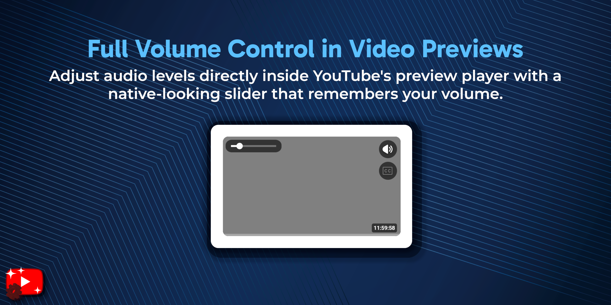
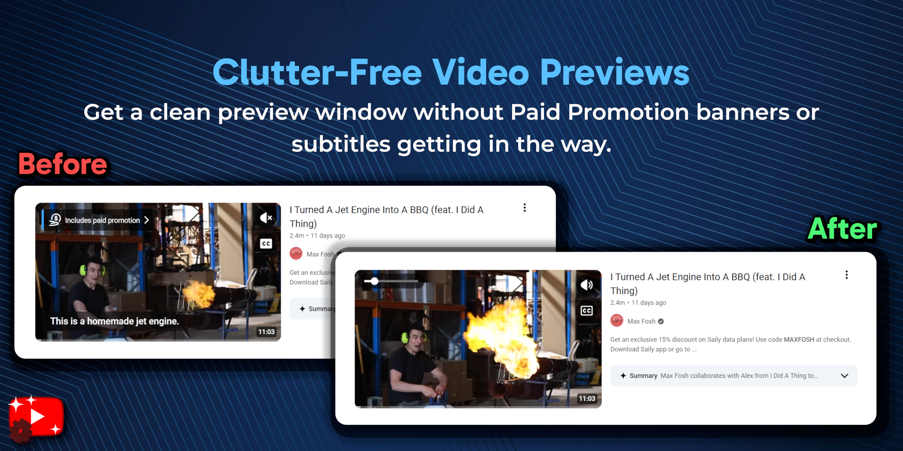
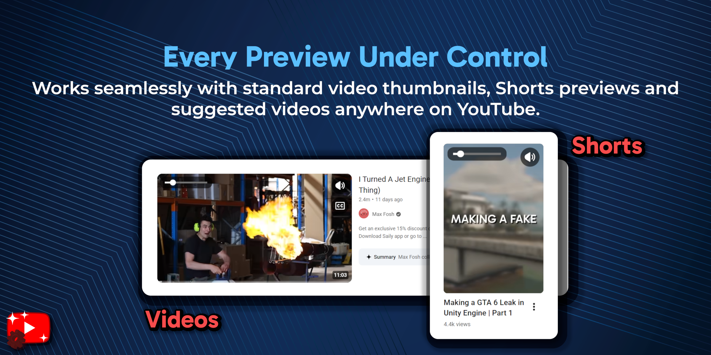
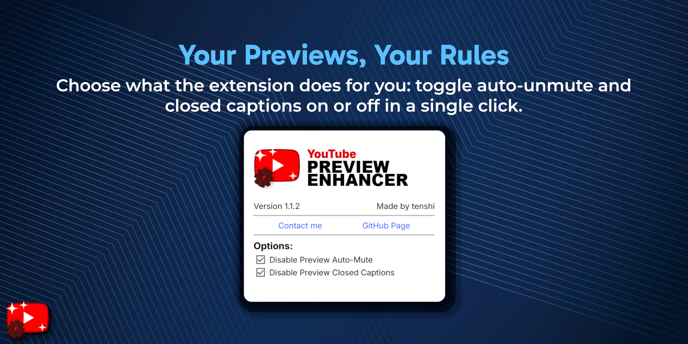

<h1> YouTube Preview Enhancer</h1>
Improve your video discovery on <b>YouTube</b>: take full control of <b>YouTube</b> <i>previews</i> with built-in volume sliders and more!

## Description
**YouTube Preview Enhancer** gives you full control over *video hover previews* on **YouTube**. Stop dealing with *muted previews*, *forced captions* or *missing volume controls* when browsing your feed.

## Features:
- **Volume Slider**: Adds a built-in volume slider directly inside the preview player. Your preferred volume level is saved automatically across sessions.
- **Auto-Unmute**: Automatically unmutes hover previews so you can hear videos immediately without clicking (can be toggled on or off in the settings).
- **Disable Closed Captions**: Automatically turns off closed captions (CC) in previews for an unobstructed view (can be toggled on or off in the settings).
- **Clutter Removal**: Strips away the "Paid Promotion" banner from the top-left corner of the preview player to free up screen space.
- **Smooth Audio Transitions**: Prevents sudden volume spikes when moving quickly between thumbnails.

## Screenshots

  
  
  
  

## How to use:
Install the extension, refresh your **YouTube** tab and hover over any video thumbnail. Use the slider in the preview player to adjust the volume or click the extension icon in your browser toolbar to configure your default mute and caption preferences.

## Installation

### Option 1: Browser Stores (Recommended)
- **Chrome Web Store:** [Install from Chrome Web Store](https://addons.mozilla.org/en-GB/firefox/addon/youtube-preview-enhancer/)
- **Firefox Add-ons:** [Install from Firefox Add-ons](https://chromewebstore.google.com/detail/youtube-preview-enhancer/ikhfamnceopipagpjehflnpflckgjfpm)

### Option 2: Manual Installation (GitHub Releases)
- Go to the [GitHub Releases](https://github.com/tenshi64/YouTube-Preview-Enhancer/releases) page and download the latest release archive (`.zip`).
- Extract the ZIP file somewhere on your computer.
- Open your browser’s Extensions or Add-ons page, and enable Developer Mode.
- Click “Load unpacked” and select the folder you just extracted.
- Refresh YouTube. You should now see the volume slider when hovering over videos on the homepage.

### Option 3: Manual Installation (from source)
- Click the green “Code” button → choose “Download ZIP”.
- Extract the ZIP file somewhere on your computer.
- Open your browser’s Extensions or Add-ons page, and enable Developer Mode.
- Click “Load unpacked” and select the folder you just extracted.
- Refresh YouTube. You should now see the volume slider when hovering over videos on the homepage.

## Privacy:
Your settings are stored locally and synced via your browser profile. This extension does not collect, track or transmit any personal data or browsing history.

## Support & Bug reports:
Found a bug or have a feature request? You can report issues directly on the project's [GitHub repository](https://github.com/tenshi64/YouTube-Preview-Enhancer/issues) or reach out on our [Discord server](https://discord.com/invite/nKyz5KZwTM).
